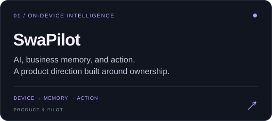
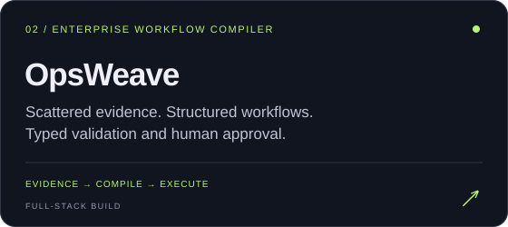
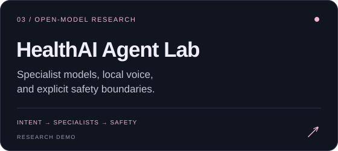
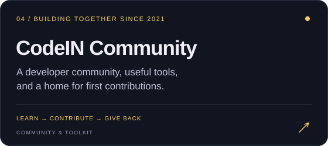
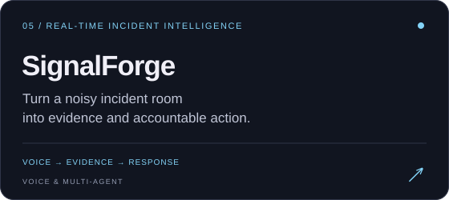
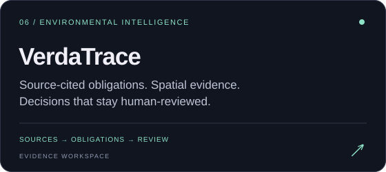

  <a href="https://sauravmukherjee.in"><picture><source media="(prefers-reduced-motion: reduce)" srcset="assets/profile/hero-static.svg" /></picture></a>

  
  
  

## I build AI systems that can show their work.

I'm **Saurav Mukherjee**, an **AI Engineer at EY** working on enterprise agents, multimodal retrieval, evaluation, and governance. Outside work, I build products that turn messy information into something people can inspect, trust, and use—and help developers find their way into open source.

**My recurring questions:** Where did the evidence come from? What can the agent actually do? Where does human judgment belong?

  

## Selected builds

Six ways I'm exploring those questions, from research and product development to community building.

<table>
  <tr>
    <td width="50%" valign="top">
      
      
<strong>SwaPilot</strong> explores an on-device AI OS for business: local intelligence, business memory, and workflows. The public repository contains the pilot website, research hub, and interactive product demo.

      
<a href="https://github.com/SauravMukherjee44/SwaPilot">Explore the pilot →</a> · <a href="https://github.com/SauravMukherjee44/Swapilot-App">App development →</a>

    </td>
    <td width="50%" valign="top">
      
      
<strong>OpsWeave</strong> turns PDFs, images, audio, spreadsheets, and API specifications into versioned workflows—with typed validation, evaluation gates, human approvals, and inspectable execution.

      
<a href="https://opsweave.sauravmukherjee.in/">Open the workspace →</a> · <a href="https://github.com/SauravMukherjee44/OpsWeave#architecture">Architecture →</a>

    </td>
  </tr>
  <tr>
    <td width="50%" valign="top">
      
      
<strong>HealthAI Agent Lab</strong> is an educational health-screening research system combining open-weight language models, local voice inference, versioned ONNX specialists, and deterministic safety controls.

      
<a href="https://healthai.sauravmukherjee.in/">Explore the research demo →</a> · <a href="https://github.com/SauravMukherjee44/HealthAI-Agent-Lab">Models & boundaries →</a>

    </td>
    <td width="50%" valign="top">
      
      
<strong>CodeIN Community</strong> is the developer community I founded in 2021. It brings together learning programs, mentorship, contribution pathways, browser utilities, maintainer tools, TypeScript libraries, and a CLI.

    </td>
  </tr>
  <tr>
    <td width="50%" valign="top">
      
      
<strong>SignalForge</strong> joins live incident rooms, turns conversation into attributable evidence, and coordinates specialist responders. Consequential actions stay under the human incident commander's control.

      
<a href="https://github.com/SauravMukherjee44/SignalForge">Explore the system →</a> · <a href="https://signalforge-architecture.netlify.app/">Interactive architecture →</a>

    </td>
    <td width="50%" valign="top">
      
      
<strong>VerdaTrace</strong> connects environmental approvals, amendments, maps, and field evidence to source-cited obligations, spatial review, and human-approved reports in an evidence-first MVP.

      
<a href="https://verdatrace.com/">Explore the workspace →</a> · <a href="https://github.com/SauravMukherjee44/VerdaTrace">Source & product scope →</a>

    </td>
  </tr>
</table>

## Beyond the code

**Good systems need good communities.** I founded CodeIN Community to help people move from following tutorials to building, collaborating, and making their first contribution.

| Community members | Events hosted | Contributors credited | Cloud learners mentored |
| :---------------: | :-----------: | :-------------------: | :---------------------: |
|    **15,000+**    |    **45+**    |        **150**        |       **4,000+**        |

The first two figures are published CodeIN milestones; 150 is its preserved contributor baseline. The 4,000+ learners reflect my work with the Google Cloud Ready Facilitator Program.

- **Maintaining in public:** CodeIN's original history and contributor credits, alongside a modern website and open developer toolkit.
- **Teaching and mentoring:** former Google DSC Lead (2022), Google Cloud Ready facilitator, and 100+ live one-to-one coding classes through ConnectBud.
- **Contributing beyond my projects:** [follow my pull requests](https://github.com/search?q=is%3Apr+author%3ASauravMukherjee44&type=pullrequests) for fixes and behavior-focused regression tests.

## My engineering toolkit

  

| Focus                  | Tools and practices                                                                                          |
| ---------------------- | ------------------------------------------------------------------------------------------------------------ |
| **Agents & retrieval** | Agentic RAG, multi-agent orchestration, MCP, Semantic Kernel, hybrid search, evaluations, guardrails         |
| **Applied AI**         | Azure AI Foundry, Azure OpenAI, Amazon Bedrock, Hugging Face, PyTorch, ONNX, scikit-learn                    |
| **Product & platform** | Python, TypeScript, FastAPI, Next.js, React, PostgreSQL, AWS, Azure, Docker, Terraform, CI/CD, observability |

At **EY**, I work on role-aware multimodal retrieval, grounded test-generation agents, and AI governance. Previously at **SMIIT**, I built ML-driven threat-detection pipelines for security telemetry. I hold a **B.Tech in Computer Science and Engineering** from Asansol Engineering College.

  
Visual credits & how this profile is built

   
  Original animated 3D SVG hero, dot-matrix footer, social icons, and project cards, paired with <a href="https://github.com/DenverCoder1/readme-typing-svg">Readme Typing SVG</a> and <a href="https://github.com/tandpfun/skill-icons">Skill Icons</a>. Inspired by the community's <a href="https://github.com/abhisheknaiidu/awesome-github-profile-readme">awesome profile READMEs</a>. The main visuals are stored in this repository. <a href="assets/profile/README.md">Asset sources and credits →</a>

## Let's build something useful.

I'm interested in applied AI, developer tools, open models, and products with a clear human purpose. Have a thoughtful problem, a collaboration idea, or a community initiative?

  <a href="https://sauravmukherjee.in"><picture><source media="(prefers-reduced-motion: reduce)" srcset="assets/profile/footer-static.svg" /></picture></a>

  
  
  
  

  
  
  
  
  

